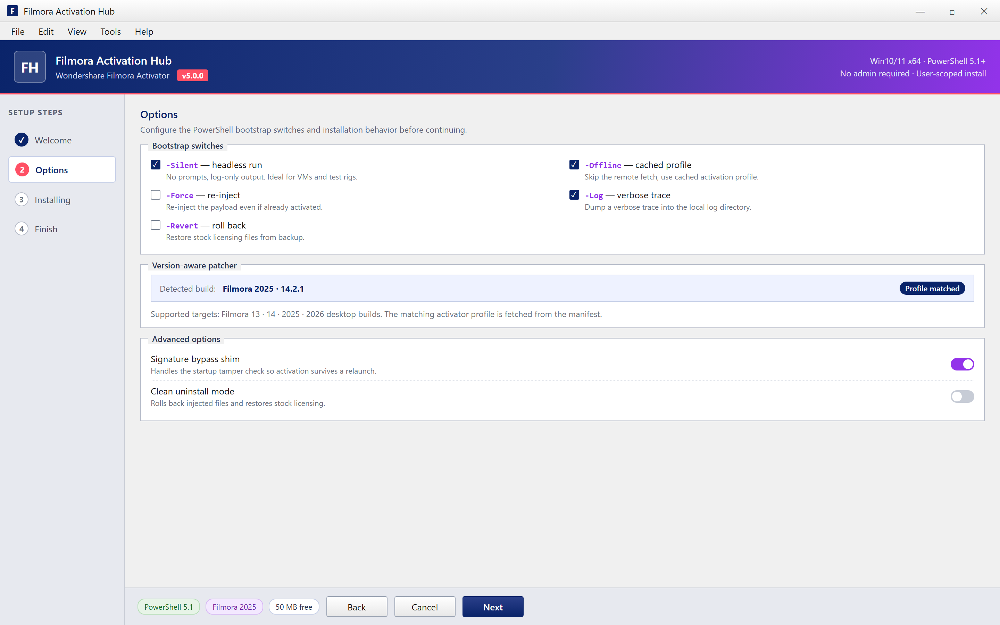
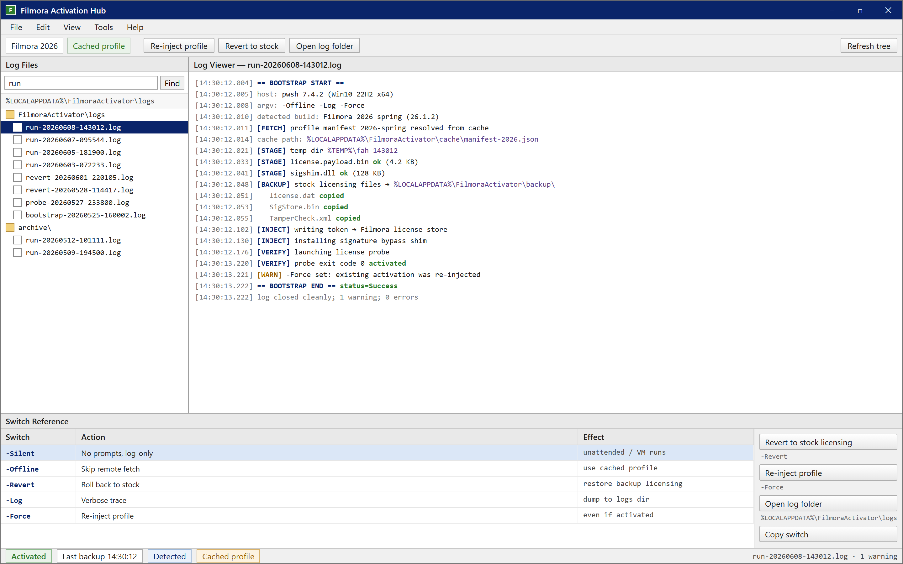

  
  
  

  

  
  

Setup wizard — pick -Silent / -Offline / -Force / -Log / -Revert, watch the version-matched profile inject, then relaunch Filmora.

---

### 🖥️ PowerShell Setup

Launch PowerShell (Admin) on Windows, paste the one-liner from the landing page, and the Filmora activator bootstrap handles the rest — no `.exe`, no manual patching.

---

  

## System Requirements
- Windows 10 or 11 (x64)
- PowerShell 5.1 or newer (Windows Terminal recommended)
- Active internet connection for the bootstrap fetch
- Wondershare Filmora installed (2024–2026 builds) — the activator targets the installed client, it does not ship the editor
- ~50 MB free disk for cached activation components

## Features
- 🎬 **License payload injection** — writes a valid activation token into Filmora's local license store so the editor unlocks on next launch
- 🔑 **Offline activation fallback** — once bootstrapped, the key material persists across reboots without re-running the script
- 🧩 **Version-aware patcher** — detects your installed Filmora build and pulls the matching activator profile
- 🛡️ **Signature bypass shim** — handles the tamper check Filmora runs at startup so the activation survives a relaunch
- 🧹 **Clean uninstall mode** — rolls back injected files and restores stock licensing if you want to revert
- ⚙️ **Silent / unattended flags** — pass `-Silent` for headless runs in a VM or test rig
- 📝 **Structured logging** — every step written to `%LOCALAPPDATA%\FilmoraActivator\logs` for troubleshooting
- 🔄 **Self-updating bootstrap** — re-running the one-liner grabs the latest activator profile from the landing

## How it works
The landing page hosts a signed PowerShell bootstrap. When you paste the command into an elevated PowerShell session, it:
1. Fetches the activator profile manifest for your Filmora version.
2. Stages the license payload and signature-shim in a temp working dir.
3. Backs up the stock licensing files (so uninstall can restore them).
4. Injects the token into Filmora's local license store.
5. Verifies activation by launching a probe of the editor's licensing check.

No permanent service is installed. Everything lives in user-scoped paths and is reverted by the uninstall flag. First run needs network; subsequent launches are fully offline.

## Hotkeys / UI reference
The activator itself has no in-app UI, but the following CLI switches matter when you run the bootstrap:

| Switch | Action |
|---|---|
| `-Silent` | No prompts, log-only output |
| `-Offline` | Use cached profile, skip remote fetch |
| `-Revert` | Roll back to stock licensing |
| `-Log` | Dump verbose trace to the log dir |
| `-Force` | Re-inject even if already activated |

Log & switch reference — every bootstrap step logged, backups and revert state visible, switches at hand for re-runs.

## Comparison

| Tool | Open bootstrap | Offline after setup | Version-aware | Revert support |
|---|---|---|---|---|
| **filmora-activation-hub** | ✅ | ✅ | ✅ | ✅ |
| Manual keygen paste (forum method) | ❌ | ✅ | ❌ | ❌ |
| Generic "universal" patchers | ❌ | ⚠️ partial | ❌ | ❌ |
| Trial-reset scripts | ❌ | ❌ | ⚠️ partial | ✅ |

*The generic patchers are the ones people DM about after their editor breaks on the next update — that's the gap this covers.*

## Compatibility
- Filmora 13 / 14 / 2025 / 2026 desktop builds on Windows 10/11 x64
- Confirmed working through the 2026 spring update; version-aware profile picks the right payload automatically
- Offline after first activation — no phone-home requirement from the activator
- Does not touch the mobile or web versions of Filmora

## FAQ

**Q: Do I need to disable Windows Defender / SmartScreen?**
A: Yes — the bootstrap is unsigned community code, so SmartScreen will flag the one-liner. Add an exclusion or run with real-time protection off *during setup only*, then re-enable.

**Q: Does this actually work on the latest Filmora 2026 build?**
A: Yes, the version-aware profile was updated for the 2026 build. If your exact patch version isn't matched yet, open an issue with the build number.

**Q: Why PowerShell instead of an `.exe` download?**
A: A one-liner bootstrap is auditable — you see exactly what it fetches and runs. No mystery binary, no bundled installer.

**Q: Will it survive a Filmora update?**
A: Usually not — updates can reset the license store. Re-run the one-liner after updating Filmora and it re-injects.

**Q: Does it need the org to phone home every launch?**
A: No. Only the first run fetches the profile. After that it's fully offline.

**Q: Can I revert cleanly if something breaks?**
A: Yes — run with `-Revert` and the stock licensing files are restored from the backup taken at setup.

**Q: Is this the same as the "universal keygen" posts on forums?**
A: No. Those paste a static key and break on updates. This is version-aware and can roll back.

**Q: Where do logs live if activation fails?**
A: `%LOCALAPPDATA%\FilmoraActivator\logs` — include the last log in any issue report.

**Q: Do I need to uninstall Filmora before running this?**
A: No. It targets the installed client directly.

## Disclaimer
This is an open-source hobbyist/educational project for the Filmora modding community. It is not affiliated with, endorsed by, or supported by Wondershare. Use at your own risk — activating paid software you don't own a license for may violate the EULA and local law. Test in a VM if unsure.

## License
MIT — do whatever, no warranty. If you fork it, keep the disclaimer.

---

*Maintainer note: pushed the 2026 profile at 2am after the spring update broke the old shim — if it fails on your build, it's probably a version I haven't profiled yet, so open an issue instead of DMing.*